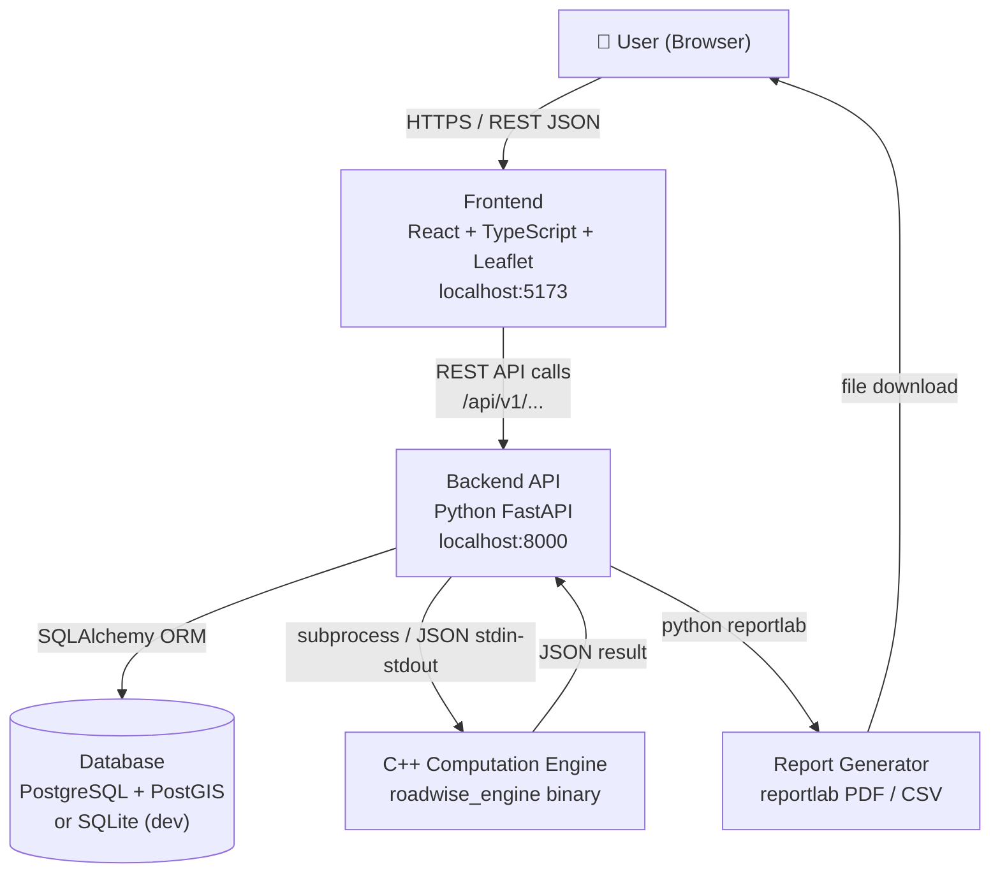
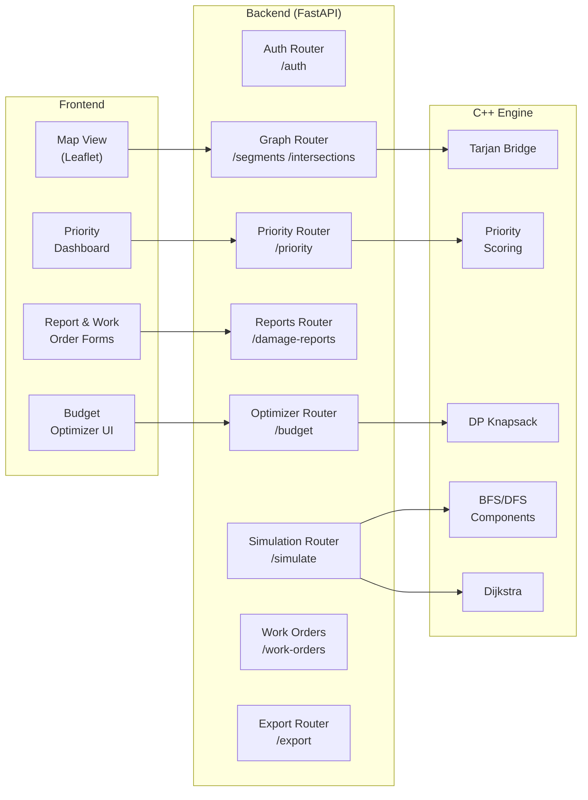
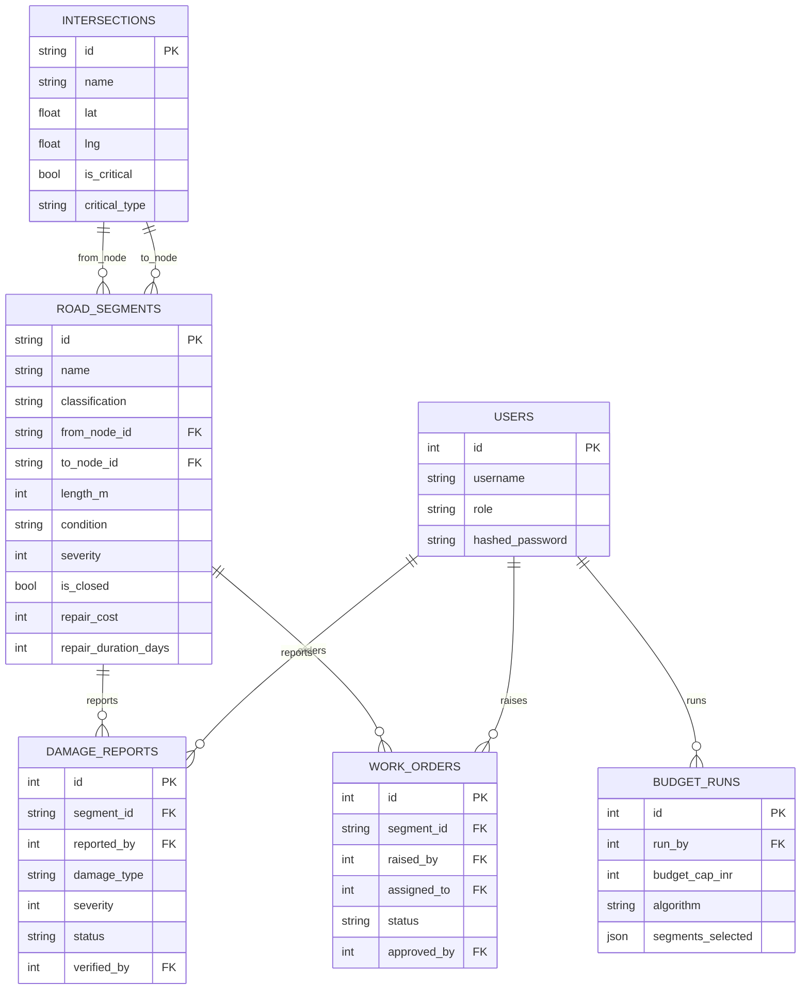
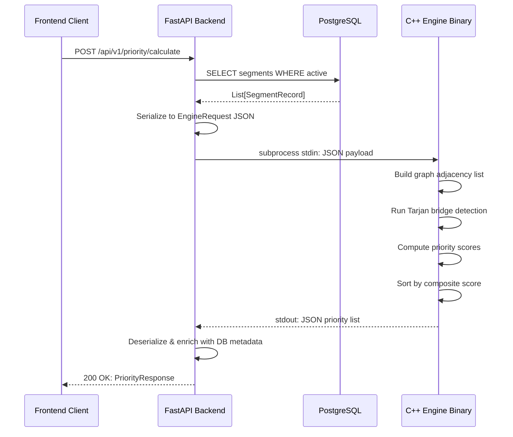
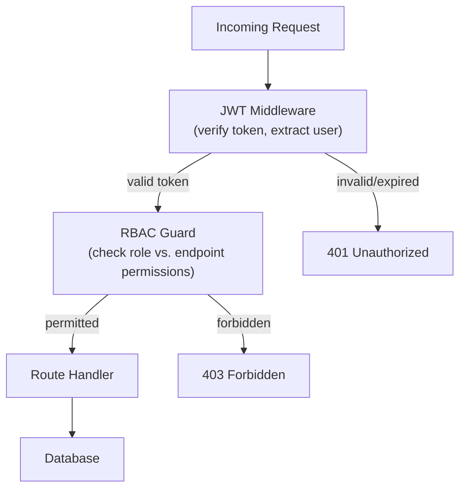
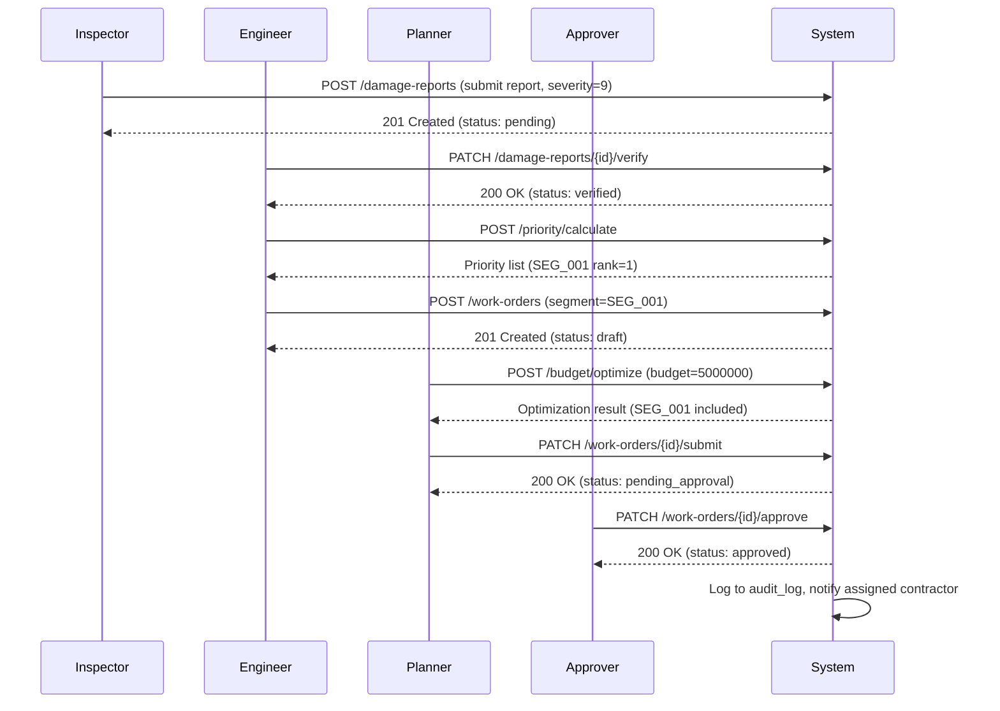
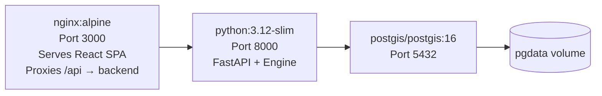

# RoadWise — System Architecture

## 1. System Overview

RoadWise is structured as a three-tier application: a high-performance C++20 computation engine, a Python FastAPI REST backend, and a React TypeScript frontend. The tiers communicate via well-defined JSON contracts.



---

## 2. Component Interaction Diagram



---

## 3. Database Schema Overview

### Core Tables

| Table | Key Columns | Description |
|-------|-------------|-------------|
| `users` | id, username, role, hashed_password | System users with role assignment |
| `intersections` | id, name, lat, lng, is_critical, critical_type | Road network nodes |
| `road_segments` | id, name, classification, from_node, to_node, length_m, condition, severity, is_closed, repair_cost | Road network edges |
| `damage_reports` | id, segment_id, reported_by, damage_type, severity, status, verified_by | Damage submissions |
| `work_orders` | id, segment_id, raised_by, assigned_to, status, approved_by, started_at, completed_at | Repair work orders |
| `budget_runs` | id, run_by, budget_cap_inr, algorithm, total_cost, segments_selected, created_at | Saved optimization runs |
| `audit_log` | id, user_id, action, entity_type, entity_id, timestamp, details | Full audit trail |

### Relationships



---

## 4. C++ Engine Integration Flow

The Python backend communicates with the C++ engine as a **subprocess** using JSON over stdin/stdout. This avoids binding complexity (no pybind11 required) while keeping the engine independently testable.



### Engine JSON Contract

**Request (stdin):**
```json
{
  "operation": "priority_score",
  "segments": [
    {
      "id": "SEG_001",
      "severity": 9,
      "traffic_importance": 10,
      "connectivity_importance": 9,
      "repair_cost": 1800000,
      "repair_duration_days": 21,
      "is_closed": false,
      "from_node": "INT_HOSP_01",
      "to_node": "N27"
    }
  ],
  "intersections": [
    {"id": "INT_HOSP_01", "is_critical": true, "critical_type": "hospital"},
    {"id": "N27", "is_critical": false}
  ]
}
```

**Response (stdout):**
```json
{
  "status": "ok",
  "results": [
    {
      "segment_id": "SEG_001",
      "priority_score": 94.7,
      "is_bridge": true,
      "rank": 1
    }
  ]
}
```

---

## 5. API Design Decisions

### RESTful Resource Naming
All resources are plural nouns: `/segments`, `/intersections`, `/damage-reports`, `/work-orders`. Actions that are not CRUD operations use sub-resources: `/priority/calculate`, `/budget/optimize`, `/simulate/closure`.

### Versioning
All endpoints are prefixed `/api/v1/` to allow future non-breaking evolution.

### Async First
The FastAPI app uses `async def` endpoints with `asyncpg` for all database operations. The C++ subprocess call is wrapped in `asyncio.create_subprocess_exec` to avoid blocking the event loop.

### Error Responses
All errors return a consistent `{"detail": "message", "code": "ERROR_CODE"}` envelope. 4xx errors are client-facing; 5xx errors log to structured stdout for monitoring.

---

## 6. Security Model



### Role Permission Matrix (summary)

| Endpoint Category | Admin | Inspector | Engineer | Planner | Approver | Auditor |
|-------------------|:-----:|:---------:|:--------:|:-------:|:--------:|:-------:|
| User management | ✅ | ❌ | ❌ | ❌ | ❌ | ❌ |
| Road network CRUD | ✅ | Read | ✅ | Read | Read | Read |
| Submit damage report | ✅ | ✅ | ✅ | ❌ | ❌ | ❌ |
| Verify damage report | ✅ | ✅ | ✅ | ❌ | ❌ | ❌ |
| Run priority engine | ✅ | ❌ | ✅ | ✅ | ❌ | ❌ |
| Run budget optimizer | ✅ | ❌ | ✅ | ✅ | ❌ | ❌ |
| Raise work order | ✅ | ❌ | ✅ | ✅ | ❌ | ❌ |
| Approve work order | ✅ | ❌ | ❌ | ❌ | ✅ | ❌ |
| Export reports | ✅ | ❌ | ✅ | ✅ | ✅ | ✅ |
| Audit log read | ✅ | ❌ | ❌ | ❌ | ❌ | ✅ |

---

## 7. Data Flow: Damage Report → Work Order



---

## 8. Deployment Architecture (Docker)


